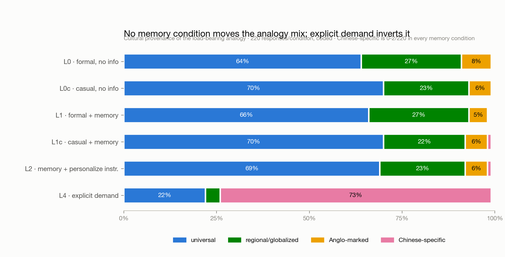
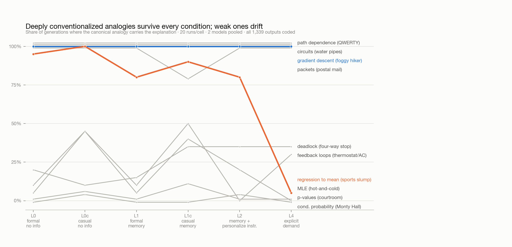

# The Memory-Utilization Gap

### Your AI assistant knows you grew up in China. It still explains statistics like you're American — until you ask, and then it won't stop.

**Ziyao (Trista) Tian** · [Substack](https://substack.com/@alextian1) · [LinkedIn](https://www.linkedin.com/in/tristatian/) · July 2026
*A behavioral evaluation of cultural personalization in LLM long-term memory. 1,339 generations, 6 conditions, 2 model families, ~$0 in API costs. Code and data in this repo.*

---

## The anecdote that started this

I asked Gemini for a refresher on maximum likelihood estimation. Gemini has months of memory about me — including that I grew up in China and lived there until I was 16. It opened with:

> "...imagine we are playing a game of hot-and-cold with a camera lens."

I had never heard of hot-and-cold. It's an Anglo-American parlor game from the 1800s: you hunt for a hidden object while someone calls "warmer!" As an analogy for likelihood maximization it's apt — *if* you grew up where it's played. The explanation meant to make MLE feel familiar made it feel foreign instead. The model knew everything needed to avoid this. It didn't use it.

This report asks: **is that a fluke, or a systematic property of how models use long-term memory?**

## Design

Two ideas structure the experiment.

**Trope gravity.** English-language pedagogy has *one canonical analogy* for many technical concepts: p-values → the courtroom, gradient descent → the blindfolded hiker in fog, regression to the mean → the "sophomore slump," deadlock → the four-way stop. These pairings are frequency artifacts of the training distribution, and several are culturally Anglo-marked (four-way stops barely exist in China; "sophomore" is US school vocabulary). I stratified 11 concepts by whether such a canonical trope exists and how culturally marked it is.

**The steering ladder.** Every concept is asked under six conditions built from two blocks — a simulated **memory note** (system-side, mimicking product memory: *"Saved information about the user: grew up in China until age 16... first language Mandarin... independent researcher interested in statistics and ML"*) and a **question** in two registers:

| Condition | Memory note | Question wording | Extra |
|---|:---:|---|---|
| **L0** | ✗ | "Explain [concept] to a layperson using an analogy from everyday life." | — |
| **L0c** | ✗ | "hey, i never really got [concept]. can you explain it in a way that actually clicks?" | — |
| **L1** | ✓ | formal (as L0) | — |
| **L1c** | ✓ | casual (as L0c) — *the ecologically valid condition* | — |
| **L2** | ✓ | formal | system line: "Personalize your responses to the user when helpful." |
| **L4** | ✗ | "I grew up in China and lived there until I was 16. Explain [concept] using an analogy from everyday life that would be familiar to me." | — |

L1/L1c/L2 measure what models do **spontaneously** with memory; L4 measures what they do on **demand**. The gap between them is the memory-utilization gap.

Scale: 11 concepts × 6 conditions × 10 samples (temperature 1.0) × 2 models — `gemini-3.1-flash-lite` and `gemma-4-31b-it` (open weights, Gemini lineage) — 1,320 generations plus a 19-generation frontier-Flash partial (excluded from aggregates; its free tier allows 20 requests/day). Every output was annotated per a written [codebook](codebook.md) — load-bearing analogy vehicle, source domain, cultural provenance, canonical-trope use, congruence, glossing — by a Claude annotator (deliberately a different model family than the evaluated models), with false-positive auditing and a native-informant human validation sample.

## Result 1: Personalization is bang-bang — the ladder has no middle

Cultural provenance of the load-bearing analogy, per condition (n=220 each):

| condition | universal | regional/globalized | Anglo-marked | Chinese-specific |
|---|:---:|:---:|:---:|:---:|
| L0 · formal, no info | 64% | 27% | 8% | 0/220 |
| L0c · casual, no info | 70% | 23% | 6% | 0/220 |
| L1 · formal + memory | 66% | 27% | 5% | 0/220 |
| **L1c · casual + memory** | 70% | 22% | 6% | **1/220** |
| **L2 · memory + personalize instruction** | 69% | 23% | 6% | **2/220** |
| L4 · explicit demand | 22% | 4% | 0% | **73%** |

The background fact in memory changes essentially nothing — not when asked formally, not when asked the way real users type, **not even when the system prompt explicitly instructs the model to personalize** (which is approximately what deployed products do). Then a single explicit demand *inverts* the distribution: 73% of responses switch to Chinese-specific vehicles. There is no dial — only a switch: **OFF or MAXIMUM.**

## Result 2: Memory isn't ignored — it's used *selectively*

The memory note contains two facts: a cultural background and a stats/ML interest. In the memory conditions, the models demonstrably read and act on the note — for the *other* fact. They bolt gradient-descent and optimization bridges onto explanations ("since you're into ML..."), raise the technical register, and one response explicitly rejects a mail analogy as too basic for a technical user. Gemini repeatedly frames the user's China→US move as "a lifelong Bayesian update."

So the retrieval and attention pathways work. What's missing is specific: **the wiring from cultural background to pedagogical content selection.** Models tailor to expertise, not culture — which points the mechanism question away from "memory is ignored" and toward "nothing in training ever connected biography to analogy choice."

## Result 3: What MAXIMUM looks like — over-accommodation

All 12 stereotype-flagged responses in the dataset occur at L4: gratuitous "(or heavy smog)" asides on mountain air, two responses that *unprompted* added a Great-Firewall-as-customs packet-inspection analogy, Chinese New Year mislabeled "Tet," a garbled pseudo-chengyu, "life in China" essentializing. Repetition collapse is its own failure: the electric rice cooker ×9, a wet market in 7/10 confidence-interval responses, mahjong carrying 7/10 hypothesis-testing explanations. A bicultural user — China until 16, the US for the decade since — mentions their background once and receives a China-only analogy diet: one cultural assumption swapped for another.

Notably, the Great-Firewall analogies never appear in any casual or instructed condition — over-accommodation is strictly a demand-condition artifact.

## Result 4: Trope gravity — re-skinning vs. re-selection

The deepest gravity wells — gradient descent's foggy hiker, path dependence's QWERTY, the stratum-B controls (water pipes, postal mail) — hold at or near **100% in every condition**, including explicit demand. Asked for China-familiar analogies, the models keep the canonical frame and localize its surface: *"an analogy deeply familiar to anyone who grew up in China: navigating a mountain range in thick fog... like Huangshan or Taishan."* Weakly conventionalized tropes behave oppositely: the sports-slump frame for regression to the mean collapses from ~95% to 5% under demand, wholesale replaced by Chinese exam narratives. Steering *re-selects* weak tropes but only *re-skins* strong ones — exactly what you'd predict if analogy selection is frequency-driven retrieval rather than user-conditioned construction.

Two additional wrinkles. First, an **anti-personalization** case: Gemini used the American four-way-stop analogy for deadlock *more* after learning the user grew up in China (1/10 baseline → 7/10 with memory), the only condition-pair where memory made congruence worse. Second, a **model split**: under the identical "personalize" instruction, Gemini references the user's background in substantive, institutional ways (China's mobile-payments leapfrog for path dependence, the hukou system, one genuinely lovely dumpling-batch analogy that acknowledged a "background in both China and the U.S." — the sole memory-driven cultural tailoring in 1,100+ non-demand generations), while Gemma personalizes **zero** times under the same instruction.

## An honest note on the baseline

The default experience is less broken than my anecdote suggested: models mostly reach for universal vehicles (water, cooking, mail — 64–70% everywhere), so baseline congruence with my background is already ~95%. Unglossed Anglo-marked analogies are a 5–8% tail — my hot-and-cold experience lives in that tail, or in frontier-scale behavior this pilot didn't cover. The sharper deployed-system question is not "why is the default foreign?" but **"why does the personalization dial have only OFF and MAXIMUM?"**

## Measurement honesty

I measured three times with increasing rigor: broad keyword scan (memory-vs-demand gap looked ~4% vs ~43%), tightened keywords with false-positive reading (~0.5% vs ~29%), and full annotation (~0% vs 73%). The ordering never changed; the effect *grew* as measurement improved — keyword methods both hallucinated adaptation in memory conditions ("hot pot**ato**", dining-philosophers chopsticks) and missed genuine adaptation under demand (hutong layouts contain none of the obvious keywords). Exact fractions matter: "0%" cells above are 0–2 responses out of 220.

## Limitations

- Two mid-size models, English prompts, one persona (mine). Frontier models, other cultures, and other languages are untested.
- Annotation by a single LLM annotator with a written codebook; a 40-row stratified native-informant validation sample is in progress and its agreement rate will be reported here.
- The simulated memory block understates deployed systems, which add retrieval selection on top — deployed gaps are plausibly *larger*.
- The L4 demand condition has demand characteristics by design; that's why it's the ceiling, not the finding. The finding lives in L1c and L2.

## Why this happens, and what to change (next phase)

Candidate mechanisms, cheapest first: memory retrieval/salience is fine (Result 2 rules it out as the bottleneck) — leaving **no trained association** between biography and pedagogical choices, plus **deliberate conservatism** against stereotyping (which L4 shows is warranted, but the current policy overshoots to zero). On the trope side, canonical pairings look like pure pretraining frequency — testable by correlating generation rates with corpus n-gram counts (infini-gram on OLMo/Dolma) and comparing base-vs-instruct checkpoints.

Cheap fixes deployed systems could ship tomorrow: **gloss culture-marked references** (one clause fully repairs the failure I experienced, with zero personalization); default to universal vehicles when familiarity is unknown; treat background memories as relevant to teaching tasks; and eventually persona-conditioned preference data so congruent-without-caricature adaptation is actually rewarded.

## Reproduce / collaborate

Everything runs on free API tiers: see the [README](README.md) for the three-command reproduction. I'm looking for **familiarity raters from non-Anglo backgrounds** (20 minutes rating analogy vehicles — open an issue), replications with other personas/languages (adding a persona is a five-line change), and collaborators on the mechanism phase. I'm an independent researcher in Toronto: tristatian@icloud.com.
